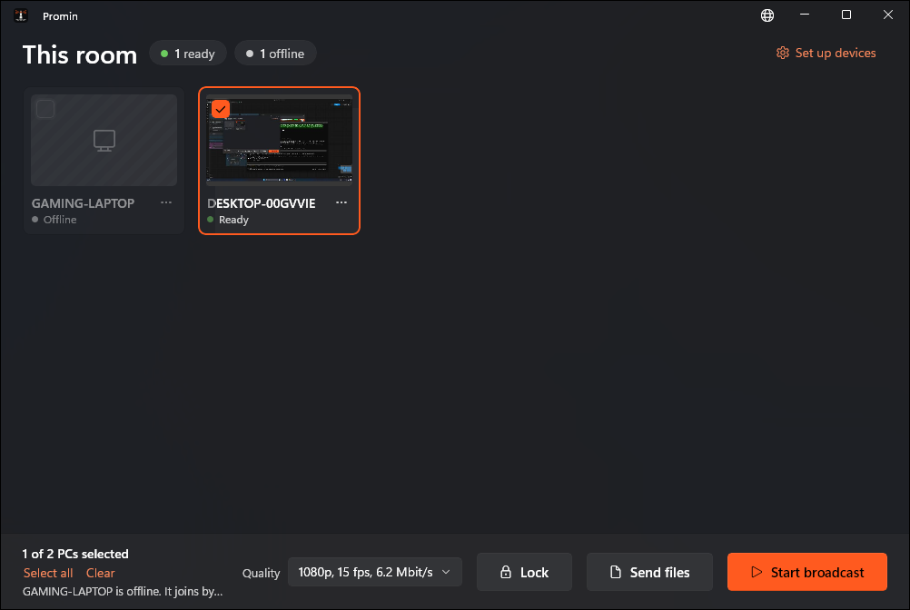

<h1>
  <picture>
    <source media="(prefers-color-scheme: dark)" srcset="assets/brand/promin-lockup-dark.svg">
    
  </picture>
</h1>

Promin shows one PC's screen on every other PC in the room, over the local network. It runs on Windows 11 and needs no server and no internet connection.

The name is Ukrainian: промінь, a beam of light.



**[Website](https://andriykohut.github.io/promin/)** · [What it does](https://andriykohut.github.io/promin/features/) · [Setting up a room](https://andriykohut.github.io/promin/docs/) · [Security](https://andriykohut.github.io/promin/docs/security/) · [Українською](https://andriykohut.github.io/promin/ua/)

Two apps make up Promin. The **console** (`Promin.Master`) runs on the PC whose screen is shown: it broadcasts that screen, shows a picture of every PC's screen, locks PCs, sends them files, controls one PC at a time, and shuts them down or restarts them. The **agent** (`Promin.Agent`) runs as a Windows service on every other PC. The setups for both are on the [releases page](https://github.com/andriykohut/promin/releases/latest).

## Status

Early. Broadcasting and sending files work and have been run between two PCs; locking and the room wall's pictures of each PC's screen have been tried on one PC. Remote control works. None of it has yet been tried in a full room of ten or more.

## Build and test

You need Windows 11 and the [.NET 10 SDK](https://dotnet.microsoft.com/download).

```
dotnet build Promin.slnx
dotnet test Promin.slnx
```

Tests that need a real screen or graphics card are skipped unless switched on in the test source.

To run the console from source, use `dotnet run --project src/Promin.Master`. Windows Firewall asks once whether to allow it; allow it on private and public networks. To run an agent without the setup, see [Advanced](https://andriykohut.github.io/promin/docs/advanced/).

### Building the setups

You need PowerShell 7.4 or newer, the .NET SDK and Inno Setup 6 (`winget install JRSoftware.InnoSetup`). Then run:

```
pwsh installer/build.ps1
```

`Promin-Console-Setup.exe` and `Promin-Agent-Setup.exe` appear in `artifacts/setup/`. Pushing a tag such as `v0.2.0` builds the same two setups with that version and attaches them to a GitHub Release.

### The website

The website lives in `site/` and is built with [Astro](https://astro.build). Each push to `main` that touches `site/` or `assets/` deploys it to GitHub Pages.

```
cd site
npm install
npm run dev
```

## Languages

The console is in English and Ukrainian. It starts in the Windows display language; the globe button in the title bar changes it, from the next start.

Every text the console shows is in `src/Promin.Master.Core/Strings.resx` (English, the source). A translation is a file beside it named for its language, such as `Strings.uk.resx`. Counted texts use the ICU plural format, so each language lists the forms it needs. Logs and the agent's terminal lines stay in English.

The website's texts are in `site/src/strings.ts`, and its docs pages in `site/src/content/docs/`, one folder per language. The site's build fails when the two languages' texts in `strings.ts` do not match up.

## Project layout

| Project | What it holds |
|---|---|
| `src/Promin.Master` | The console app (WinUI 3), including the control window (`Control/`) |
| `src/Promin.Master.Core` | The console's logic, free of UI code, including the control session (`Control/`) |
| `src/Promin.Agent` | The agent app |
| `src/Promin.Protocol` | Discovery, pairing, transport and the broadcast session |
| `src/Promin.MediaPipeline` | Screen capture, H.264 encoding and decoding, and showing a decoded picture (`Presenting/`) |
| `tests/` | One test project per project above, except the console app |
| `site/` | The website and its docs, in English and Ukrainian |

## Licence

[MIT](LICENSE)
