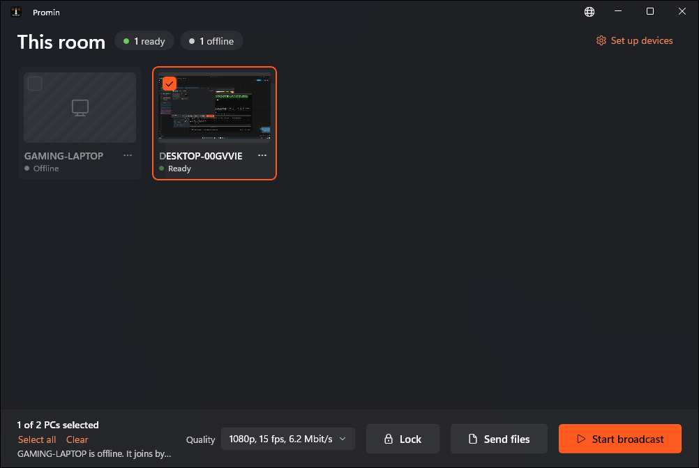

<h1>
  <picture>
    <source media="(prefers-color-scheme: dark)" srcset="assets/brand/promin-lockup-dark.svg">
    
  </picture>
</h1>

Promin shows one PC's screen on every other PC in the room, over the local network. It runs on Windows 11 and needs no server and no internet connection.

The name is Ukrainian: промінь, a beam of light.



## Status

Early. Broadcasting and sending files work and have been run between two PCs; locking and the room wall's pictures of each PC's screen have been tried on one PC. None of it has yet been tried in a full room of ten or more.

Planned next, not built yet: remote control.

## How it works

There are two apps:

- **The console** (`Promin.Master`) runs on the PC whose screen is shown. It lists the PCs in the room, starts and stops the broadcast, shows each PC's screen in its tile, refreshed about once a second, sends files and folders to the PCs, and locks the ticked PCs (one, a few or all) with an optional message of up to 100 characters, and unlocks them with one click.
- **The agent** (`Promin.Agent`) runs on every other PC. It has no window of its own; when a broadcast starts, it covers the display with the picture and blocks the keyboard and mouse until the broadcast's window closes. It shows the lock screen the same way when the console locks the PC. It also sends a small picture of its screen to the console about once a second, and saves the files the console sends, opening them for the person signed in when the console asks.

A lock is kept on the PC itself, so it survives a restart, a sign-out and the console being closed, and comes back a moment after sign-in. A console on the same PC neither locks nor blocks.

Agents announce themselves on the network and the console finds them. A PC joins a room once, by pairing: both sides must know the same six-digit room code, and the code itself never crosses the network. After pairing, each side accepts only the other's certificate. The picture travels as H.264 video over QUIC, encoded and decoded on the graphics card where there is one.

## Requirements

- Windows 11 on every PC (Windows 10 has no QUIC support)
- All PCs on the same local network; wired is better than Wi-Fi
- The [.NET 10 SDK](https://dotnet.microsoft.com/download) to build

## Build and test

```
dotnet build Promin.slnx
dotnet test Promin.slnx
```

Tests that need a real screen or graphics card are skipped unless switched on in the test source.

## Setting up a room

Every PC needs Windows 11 with Smart App Control off, and it has to stay off: Promin's programs are not signed yet, so Windows blocks them while it is on or in evaluation. The setups check this and do not install until it is off. Step by step: [українською](docs/smart-app-control-uk.md), [in English](docs/smart-app-control-en.md). Windows also shows "Windows protected your PC" for the unsigned setups: choose **More info**, then **Run anyway**. If an IT policy blocks unsigned apps, only the PC's administrator can allow Promin.

**Building the setups.** You need PowerShell 7.4 or newer, the .NET SDK and Inno Setup 6 (`winget install JRSoftware.InnoSetup`). Then run:

```
pwsh installer/build.ps1
```

`Promin-Console-Setup.exe` and `Promin-Agent-Setup.exe` appear in `artifacts/setup/`. Copy them to a USB stick. Pushing a tag such as `v0.2.0` builds the same two setups with that version and attaches them to a GitHub Release.

**On the console PC**, run `Promin-Console-Setup.exe`, then open **Promin** from the Start menu. The setup installs the console to `C:\Program Files\Promin\Console` and adds a Windows Firewall rule named `Promin console` (UDP 17844, for the console's program only).

**On every other PC**, run `Promin-Agent-Setup.exe`. It asks nothing beyond one **Install** click. It installs the agent to `C:\Program Files\Promin\Agent`, registers it as a Windows service that starts with Windows, opens the agent's firewall port, then opens the **Promin agent** window.

1. In the window, type the room code (pick your own six digits) and save it.
2. On the console, open **Set up devices**, enter the same code and choose **Pair**.

The window shows one of three statuses: "No room code yet", "Not paired yet" or "Paired". Reopen it any time from the Start menu as **Promin agent**; it needs administrator rights.

**Upgrading and uninstalling.** Run a newer setup to upgrade in place. An upgrade keeps the room code and pairing and does not open the window. Upgrade every agent PC before using **Send files**: an agent from an earlier version cannot receive files, so a send to it fails or waits until you stop it. On an agent PC that was set up by hand (a copied folder plus `--install`), running `Promin-Agent-Setup.exe` takes over that service, and the old folder can be deleted afterwards. To remove Promin, uninstall it from Installed apps. The agent keeps its room code, identity, pairing and any lock in `C:\ProgramData\Promin`, and the console keeps `%LocalAppData%\Promin`, so a reinstall needs no new pairing, and a reinstall on a locked PC locks it again.

### Without the installer

To run the console from source, use `dotnet run --project src/Promin.Master`. Windows Firewall asks once whether to allow it; allow it on private and public networks.

For an agent, publish a self-contained copy (no .NET install needed on that PC):

```
dotnet publish src/Promin.Agent -c Release -r win-x64 --self-contained true -o src/Promin.Agent/bin/publish/win-x64
```

Copy the folder to the PC, set the room code with `.\Promin.Agent.exe --set-room-code 482913 | Out-Host` (`| Out-Host` makes its one line of reply show up), then run `.\Promin.Agent.exe --install` in an **administrator** terminal and pair from the console as above.

Agent commands:

| Command | What it does |
|---|---|
| `Promin.Agent.exe --install` | Registers the agent as a service that starts with Windows, adds its firewall rule, and locks the data folder (administrator terminal) |
| `Promin.Agent.exe --uninstall` | Removes the service and its firewall rule, leaving the pairing, identity and lock files |
| `Promin.Agent.exe --windowed` | Shows the broadcast in an ordinary window instead of covering the display |
| `Promin.Agent.exe --reset-pairing` | Forgets the paired console and removes the lock, so the PC can be paired again |

The service runs the agent under the SYSTEM account, so every PC pairs once more the first time it is installed (the agent's identity moves to that account).

## Security notes

- Nobody on the network can watch or alter the broadcast or the screen pictures, pair without the room code, or recover the code from the traffic.
- The room code is stored in a file that people using that PC can read. Pair each PC straight after setting its code. Until it is paired, anyone who knows the code can pair it to a different console.
- On **Set up devices**, pair only the PCs you can account for. A device that knows the code can announce itself under any name.
- Any device on the same network can disrupt Promin (for example, keep PCs from connecting), though it cannot watch.
- Only the paired console can unlock a PC. If the console is lost or a PC is stuck, an administrator starts that PC in Safe Mode and, in the agent's folder (`C:\Program Files\Promin\Agent`), runs `.\Promin.Agent.exe --reset-pairing | Out-Host`, which also removes the lock file. The PC must then pair again.
- A program sent to a PC is saved but never run, even when **Open them on each PC when they arrive** is ticked.

## Languages

The console is in English and Ukrainian. It starts in the Windows display language; the globe button in the title bar changes it, from the next start.

Every text the console shows is in `src/Promin.Master.Core/Strings.resx` (English, the source). A translation is a file beside it named for its language, such as `Strings.uk.resx`. Counted texts use the ICU plural format, so each language lists the forms it needs. Logs and the agent's terminal lines stay in English.

## Where things are kept

| What | Where |
|---|---|
| Console data and log | `%LocalAppData%\Promin` |
| Agent data and log | `%ProgramData%\Promin\Agent` |
| Lock on an agent PC | `%ProgramData%\Promin\Agent\lock.json` |
| Room code on an agent PC | `%ProgramData%\Promin\agent.json` |
| Files sent to an agent PC | `Promin` on the desktop of the person signed in there |

## Project layout

| Project | What it holds |
|---|---|
| `src/Promin.Master` | The console app (WinUI 3) |
| `src/Promin.Master.Core` | The console's logic, free of UI code |
| `src/Promin.Agent` | The agent app |
| `src/Promin.Protocol` | Discovery, pairing, transport and the broadcast session |
| `src/Promin.MediaPipeline` | Screen capture, H.264 encoding and decoding |
| `tests/` | One test project per project above, except the console app |

## Licence

[MIT](LICENSE)
